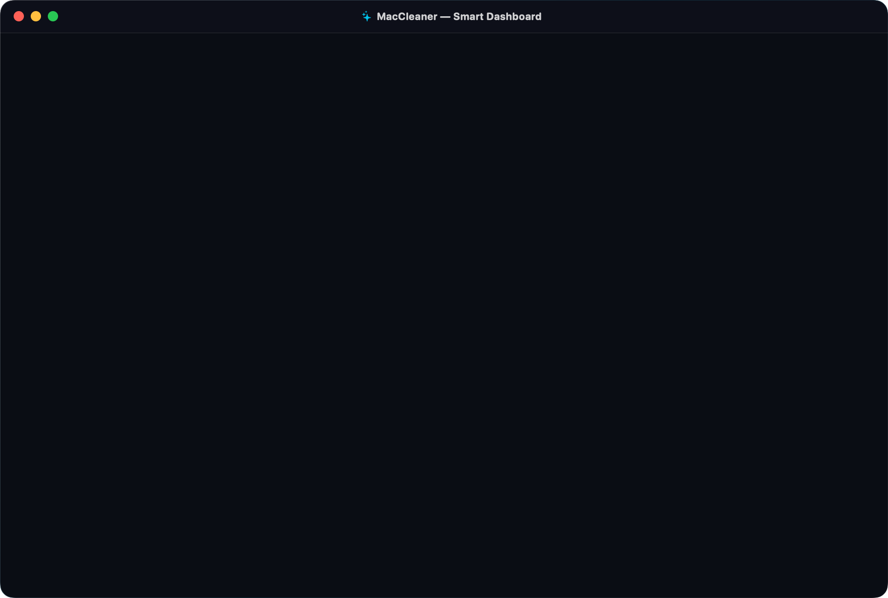
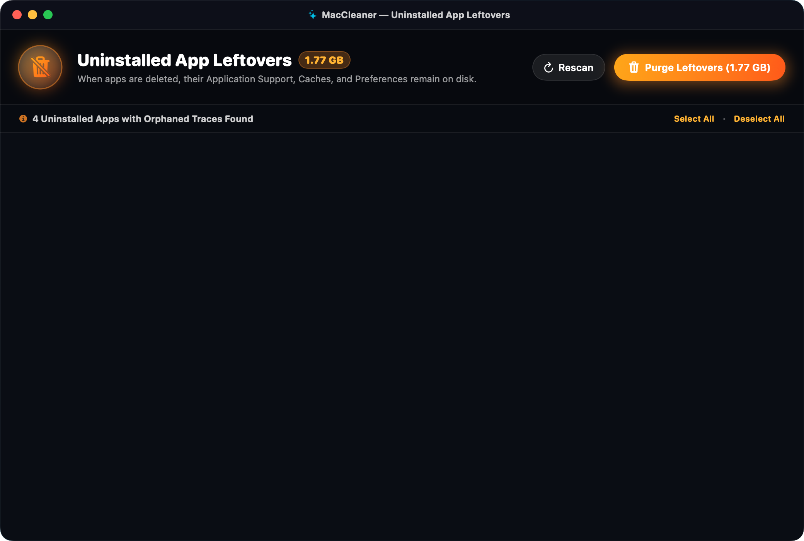
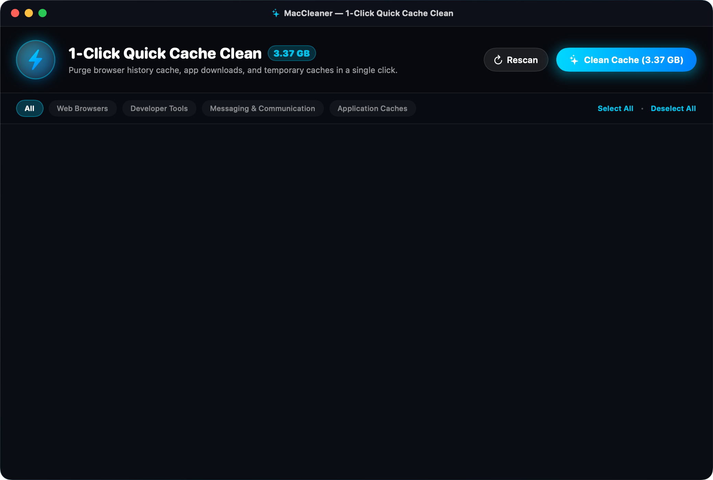
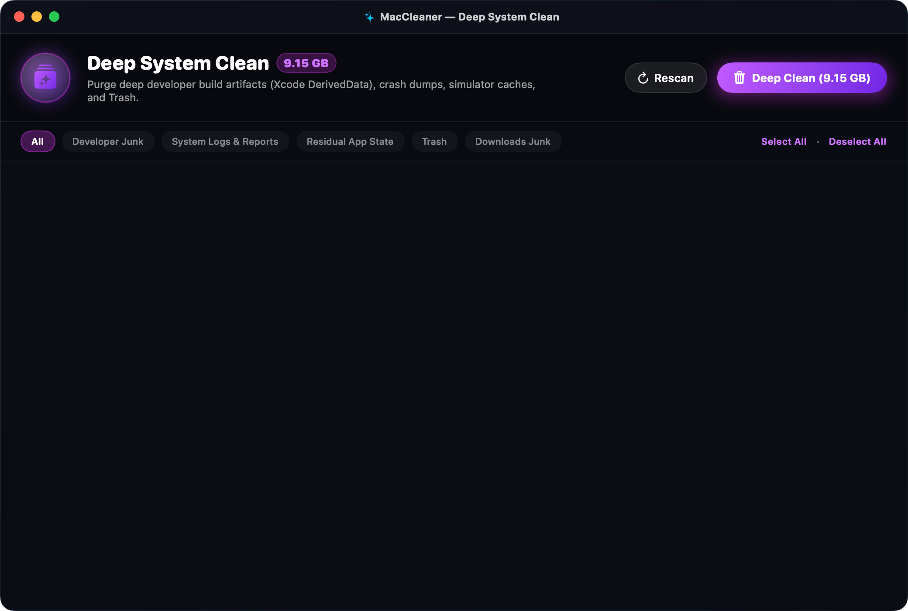

<p align="center">
  
</p>

<h1 align="center">MacCleaner PRO</h1>

<p align="center">
  <b>High-Performance, Native macOS System Cleaner & Uninstalled App Leftovers Remover</b><br/>
  <i>Engineered in 100% Native Swift 6 & SwiftUI for Apple Silicon (M1/M2/M3/M4)</i>
</p>

<p align="center">
  
  
  
  
  
</p>

---

## 📸 Screenshots

### 🌌 Smart Performance Hub (Dashboard)
> *Features a holographic dual-ring storage core, real-time memory & disk telemetry, live radar scanner, and one-click smart cleaning across all modules.*

<p align="center">
  
</p>

---

### 📦 Uninstalled App Leftovers Remover
> *When you drag an application to the Trash on macOS, its supporting files, cache, and preferences remain. MacCleaner detects and purges these orphaned remnants with granular file review and Finder reveal.*

<p align="center">
  
</p>

---

### ⚡ 1-Click Quick Cache Clean
> *Purge gigabytes of user application caches, web browser history caches (Chrome, Safari, Brave, Edge, Firefox), and messaging data without resetting credentials.*

<p align="center">
  
</p>

---

### 🧹 Deep System Clean
> *Deep-rooted developer junk (Xcode DerivedData, iOS simulator runtimes, build indexes), diagnostic crash reports, and system Trash.*

<p align="center">
  
</p>

---

## ✨ Features at a Glance

| Feature | Description | Safe by Default |
| :--- | :--- | :---: |
| **⚡ 1-Click Cache Clean** | User caches, Chrome, Safari, Brave, Slack, Spotify, and QuickLook thumbnails | ✅ |
| **📦 App Leftovers Remover** | Orphaned `Application Support`, `Caches`, `Containers`, and `.plist` files | ✅ |
| **🧹 Deep Clean** | Xcode DerivedData, iOS Simulator runtimes, CocoaPods, NPM, logs, crash dumps | ✅ |
| **🗄️ Large & Old Files** | Forgotten DMG disk images, installer packages (`.pkg`), and heavy archives | ✅ |
| **🛡️ Safe Trash Deletion** | Cleaned items are moved to macOS Trash with 100% reversible "Put Back" | ✅ |
| **🛡️ Protected Whitelist** | Documents, Desktop, Photos, Keychains, and Apple SIP services are untouchable | ✅ |
| **⚡ Native ARM64 Speed** | Launches in milliseconds, zero electron bloat, instant scan speeds | ✅ |

---

## 🚀 Getting Started

### Option 1: Native GUI App
Double-click `MacCleaner.app` in Finder, or launch from Terminal:
```bash
open MacCleaner.app
```
Or use the launcher script:
```bash
./Scripts/run.sh
```

### Option 2: Command-Line Interface (CLI)
A standalone CLI binary is ready at `build/mac-cleaner`:

```bash
# Check Mac storage status
./build/mac-cleaner status

# Full system scan
./build/mac-cleaner scan

# 1-Click Cache Clean
./build/mac-cleaner quick-clean

# Deep clean developer junk, logs, and trash
./build/mac-cleaner deep-clean

# Clean leftovers from uninstalled apps
./build/mac-cleaner leftovers

# Sweep all junk categories
./build/mac-cleaner clean-all

# Simulation mode (does not delete any files)
./build/mac-cleaner leftovers --dry-run
```

---

## 🛠️ Building from Source

To compile the release bundle and CLI tool:
```bash
./Scripts/build.sh
```

---

## 📁 Repository Structure

```
Mac cleaner/
├── MacCleaner.app/                  # Compiled macOS Application Bundle
├── Package.swift                    # Swift Package Manager manifest
├── Sources/
│   ├── MacCleanerEngine/            # Core scanning & cleaning engine
│   │   ├── Models/                  # JunkItem, CleanCategory, SystemStats, ScanResult
│   │   ├── Scanners/                # CacheScanner, DeepCleanScanner, LeftoverScanner, LargeFilesScanner
│   │   ├── Cleaner/                 # CleanEngine, SystemSafety (whitelists)
│   │   └── System/                  # DiskManager, AppDiscovery
│   ├── MacCleanerApp/               # SwiftUI Native macOS GUI
│   │   ├── AppMain.swift            # App entry point
│   │   ├── Theme/                   # DesignSystem & glassmorphism
│   │   ├── ViewModels/              # CleanerViewModel (state & async tasks)
│   │   └── Views/                   # Dashboard, QuickClean, DeepClean, Leftovers, LargeFiles, Settings
│   └── MacCleanerCLI/               # Terminal tool (CLIMain.swift)
├── Resources/
│   ├── AppIcon.icns                 # High-resolution application icon
│   ├── AppIcon_1024.png             # 1024x1024 master icon
│   ├── Screenshots/                 # 2x Retina application screenshots
│   └── Info.plist                   # App metadata and bundle configuration
├── docs/
│   └── screenshots/                 # GitHub README screenshot assets
├── Scripts/
│   ├── build.sh                     # Automated release build & packaging script
│   ├── run.sh                       # Quick launch script
│   ├── generate_icon.swift          # Programmatic icon generator
│   └── generate_screenshots.swift   # High-resolution screenshot renderer
└── README.md
```

---

<p align="center">
  Made for macOS with ❤️ using Swift & SwiftUI.
</p>
